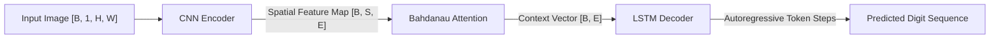

# Multi-Digit Handwritten Sequence Recognition

PyTorch repository for **Task 3 – Image-to-Sequence Prediction: Handwritten Digit Sequence Recognition**, using an **Attention-based CNN Encoder–LSTM Decoder**.

---

## 1. Project Overview & Problem Definition

- **Input:** A grayscale image containing a variable-length sequence of handwritten digits (e.g., 1 to 5 digits).
- **Output:** The corresponding numerical digit sequence string (e.g., `"78055"`, `"4878"`).
- **Vocabulary:** Digits `'0'–'9'` (`0–9`), `<PAD>` (`10`), `<SOS>` (`11`), `<EOS>` (`12`).

---

## 2. Repository Structure

```text
multi-digit-sequence-recognition/
├── configs/
│   ├── default.yaml              # Paths, image size, model & training hyperparameters (local/auto)
│   └── colab_gpu.yaml            # Preset for Google Colab GPU (cuda, batch_size=128, num_workers=2)
├── notebooks/
│   └── colab_gpu.ipynb           # Self-contained turnkey Google Colab GPU notebook (generated)
├── scripts/
│   ├── generate_colab_notebook.py # Build/refresh notebooks/colab_gpu.ipynb from src/ and configs/
│   └── pull_colab_results.py      # Extract colab_results.zip into local checkpoints/ and outputs/
├── src/
│   ├── config.py                 # YAML config loader, device selection, random seed
│   ├── utils.py                  # Plots (samples, length distribution, loss curves, attention)
│   ├── metrics.py                # Exact Match, Char Acc, CER + R², NSE, MAE, RMSE
│   ├── data/
│   │   ├── __init__.py
│   │   ├── labels.py             # Vocabulary, label extraction & validation
│   │   ├── preprocessing.py      # Grayscale, aspect-preserving resize, padding, normalization
│   │   ├── dataset.py            # PyTorch Dataset & variable-length batch collation
│   │   └── splitting.py          # Stratified train/val/test splits + leakage check
│   ├── models/
│   │   ├── __init__.py
│   │   ├── encoder.py            # CNNEncoder -> spatial sequence [B, S, E]
│   │   ├── attention.py          # BahdanauAttention (additive attention)
│   │   ├── decoder.py            # LSTMDecoder (autoregressive step-by-step)
│   │   └── seq2seq.py            # CNNSeq2Seq (training forward + greedy predict)
│   ├── download_data.py          # Step 1: Download / extract Kaggle dataset into data/raw/
│   ├── inspect_data.py           # Step 2: Validate images/labels, EDA plots, create splits
│   ├── train.py                  # Step 4: Train, validate, save checkpoints & loss curves
│   ├── evaluate.py               # Step 5: Evaluate checkpoint on train/val/test split
│   ├── predict.py                # Step 6a: Predict digit sequence for a single image
│   └── demo.py                   # Step 6b: Visualize batch predictions & attention heatmap
├── tests/
│   ├── test_labels.py
│   ├── test_dataset.py
│   ├── test_metrics.py
│   └── test_model_shapes.py
├── data/
│   ├── raw/
│   ├── processed/
│   └── splits/
├── checkpoints/
├── outputs/
├── pyproject.toml
├── .env.example
├── .gitignore
└── README.md
```

---

## 3. Dataset Source & Verified Label Format

Derived directly from `multi-digit-sequence-recognition.ipynb` (`https://www.kaggle.com/code/fellahabdelnour13/multi-digit-sequence-recognition/input`):

- **Reference mount path:** `/kaggle/input/multidigit-mnist` (`datasetVersion` `sourceId: 9136180`).
- **Expected layout under `data/raw/`:**
  - `data/raw/train/train/*.png` (50,000 grayscale images in reference notebook)
  - `data/raw/test/test/*.png` (~10,000 grayscale images in reference notebook)
- **Image dimensions:** Grayscale `.png` (`uint8`), height `32` px, width `32 * num_digits` px (e.g., `32x128` for 4 digits, `32x160` for 5 digits).
- **Verified label extraction rule:**
  ```python
  label = os.path.splitext(filename)[0].split("_")[-1]
  ```
  Example: `00001_78055.png` → `"78055"`. Configurable in `configs/default.yaml` (`filename_suffix`, `filename_stem`, or `annotation_file` CSV/JSON).

---

## 4. Model Architecture



- **CNN Encoder (`src/models/encoder.py`):** 4 convolutional blocks (`Conv2d` + `BatchNorm2d` + `ReLU` + `MaxPool2d`) preserving left-to-right horizontal order via height-only pooling in block 3 and `AdaptiveAvgPool2d((1, None))`, producing `[B, S, E]`.
- **Bahdanau Attention (`src/models/attention.py`):** Computes attention weights over the `S` spatial positions using the decoder hidden state as query and produces a weighted context vector `[B, E]`.
- **LSTM Decoder (`src/models/decoder.py`):** Autoregressive LSTM trained with `CrossEntropyLoss(ignore_index=PAD_ID)` and teacher forcing; inference decodes greedily until `<EOS>` or `max_decode_length`.

---

## 5. Evaluation Metrics & Limitations

- **Full-set recognition metrics:** `Exact Sequence Accuracy`, `Character Accuracy`, and `CER` (edit distance / total true characters).
- **Assignment numerical metrics ($R^2$, NSE, MAE, RMSE):**
  $$R^2 = \text{NSE} = 1 - \frac{\sum_i (y_i - \hat{y}_i)^2}{\sum_i (y_i - \bar{y})^2}, \quad \text{MAE} = \frac{1}{N} \sum_i |y_i - \hat{y}_i|, \quad \text{RMSE} = \sqrt{\frac{1}{N} \sum_i (y_i - \hat{y}_i)^2}$$
  Because digit tokens `'0'–'9'` are categorical classes and sequence lengths can differ, these four metrics are computed **only on aligned digit positions from samples where predicted length == ground-truth length** (excluding `<PAD>`, `<SOS>`, `<EOS>`), with equal-length subset coverage explicitly reported. Zero-coverage and zero-variance cases are safely reported as `null`.

---

## 6. Installation & Environment Setup

Requires **Python >= 3.10**. Run all commands from the repository root (`D:\multi-digit-sequence-recognition`).

### 6.1. Option A — Recommended: Setup with `uv`

`uv sync` automatically creates `.venv` and installs all core and `dev` dependencies defined in `pyproject.toml`:

- **Windows (PowerShell):**
  ```powershell
  cd D:\multi-digit-sequence-recognition
  uv sync --extra dev --no-install-project
  # If script execution is restricted in the current session, run first:
  # Set-ExecutionPolicy -ExecutionPolicy RemoteSigned -Scope Process
  .\.venv\Scripts\Activate.ps1
  ```
- **Linux / macOS:**
  ```bash
  uv sync --extra dev --no-install-project
  source .venv/bin/activate
  ```

> **Note:** `--no-install-project` is passed because `pyproject.toml` does not define a `[build-system]` and scripts in `src/` are executed directly with `python src/<script>.py`.

### 6.2. Option B — Fallback: Setup with `venv` + `pip`

```bash
python -m venv .venv
```

- **Windows (PowerShell):**
  ```powershell
  .\.venv\Scripts\Activate.ps1
  ```
- **Linux / macOS:**
  ```bash
  source .venv/bin/activate
  ```

Install dependencies:

```bash
python -m pip install --upgrade pip
pip install torch torchvision pillow numpy pandas matplotlib scikit-learn pyyaml tqdm pytest kagglehub kaggle
```

> **GPU (CUDA) Note:** If you have an NVIDIA GPU and want a specific CUDA wheel, install `torch` and `torchvision` from the [PyTorch installation index](https://pytorch.org/get-started/locally/) before or after syncing/installing the remaining packages (e.g., `uv pip install torch torchvision --index-url https://download.pytorch.org/whl/cu124`).

### 6.3. Configure `.env` (for Automatic Kaggle Download)

Copy `.env.example` to `.env` (`.env` is gitignored):

- **Windows (PowerShell):**
  ```powershell
  Copy-Item .env.example .env
  ```
- **Linux / macOS:**
  ```bash
  cp .env.example .env
  ```

Open `.env` and fill in your Kaggle dataset slug and credentials:

```env
# Optional Kaggle API credentials (do NOT commit .env or kaggle.json)
KAGGLE_USERNAME=your_kaggle_username
KAGGLE_KEY=your_kaggle_api_key

# Dataset slug copied from the Input tab of:
# https://www.kaggle.com/code/fellahabdelnour13/multi-digit-sequence-recognition/input
KAGGLE_DATASET_SLUG=<owner>/<dataset-slug>
```

> **Alternative Kaggle Auth:** Instead of setting `KAGGLE_USERNAME` and `KAGGLE_KEY` in `.env`, you can place your `kaggle.json` API token in `%USERPROFILE%\.kaggle\kaggle.json` (Windows) or `~/.kaggle/kaggle.json` (Linux/macOS).

---

## 7. Step-by-Step Pipeline (Commands & Output Locations)

Run every command from the repository root (`multi-digit-sequence-recognition/`) with `.venv` activated:

### Step 1 — Download / Extract Dataset

- **Option A — Automatic download via `kagglehub` (using `.env` or `--slug`):**
  ```bash
  python src/download_data.py --config configs/default.yaml
  # Or pass the dataset slug directly (overrides KAGGLE_DATASET_SLUG in .env):
  # python src/download_data.py --config configs/default.yaml --slug <owner>/<dataset-slug>
  ```
- **Option B — Manual download:**
  1. Download the dataset `.zip` archive (or extracted `train/` and `test/` folders) from Kaggle into `data/raw/`.
  2. Run `python src/download_data.py --config configs/default.yaml` to automatically extract any `data/raw/*.zip` archives and print image counts and subfolders.

- **Output:**
  - `data/raw/` — extracted dataset images (e.g., `data/raw/train/train/*.png`, `data/raw/test/test/*.png`).

### Step 2 — Inspect, Validate & Split Dataset

```bash
python src/inspect_data.py --config configs/default.yaml

# Optional flags:
# --verify-images       Run PIL Image.verify() on every image (skipped by default)
# --no-progress         Disable tqdm progress bar
# --num-samples 5       Number of sample images to plot in outputs/sample_images.png
```

- **Output:**
  - `data/processed/metadata.csv` — validated `image_path, label, sequence_length, original_split`.
  - `data/processed/validation_report.json` — scanned/valid/rejected counts and reasons.
  - `data/splits/train.csv`, `data/splits/val.csv`, `data/splits/test.csv` — leak-free splits.
  - `data/splits/split_summary.json` — split sizes and sequence length distributions.
  - `outputs/sample_images.png` — sample images with extracted labels.

> **Custom Dataset Labels:** If your images do not follow `<id>_<digits>.png`, adjust `data.label_extraction` (`filename_suffix`, `filename_stem`, or `annotation_file`) in `configs/default.yaml`.

### Step 3 — Verify Model Shapes (Quick Sanity Check)

```bash
python src/models/seq2seq.py
```

- **Output (stdout):** Tensor shapes for `Input shape`, `Encoder output`, `Train logits`, `Predict IDs`, `Attention map`, and total parameter count.

### Step 4 — Train Model

```bash
python src/train.py --config configs/default.yaml

# Optional overrides and resume:
# python src/train.py --config configs/default.yaml --epochs 20 --batch-size 64
# python src/train.py --config configs/default.yaml --device cuda --num-workers 2 --batch-size 128
# python src/train.py --config configs/default.yaml --resume checkpoints/final_model.pt
# python src/train.py --config configs/default.yaml --no-progress
```

- **Key training settings (`configs/default.yaml`):** `device: "auto"` (`auto`/`cpu`/`cuda`), `epochs: 15`, `batch_size: 32`, `learning_rate: 0.001` with `ReduceLROnPlateau(factor=0.5, patience=2)`, scheduled `teacher_forcing_start: 0.8` → `teacher_forcing_end: 0.3`, `early_stopping_patience: 5`, `num_workers: 0` (safe default on Windows). When `device` resolves to `cuda`, `pin_memory=True` is automatically enabled on DataLoaders.
- **Google Colab GPU preset (`configs/colab_gpu.yaml`):** Sets `device: "cuda"`, `batch_size: 64`, `num_workers: 2`, `epochs: 35`, `early_stopping_patience: 8`, `ReduceLROnPlateau`, and scheduled teacher forcing (`0.8 -> 0.3`). Or open `notebooks/colab_gpu.ipynb` directly in Google Colab.
- **Output:**
  - `checkpoints/best_model.pt` — checkpoint with lowest validation loss.
  - `checkpoints/final_model.pt` — checkpoint from the last completed epoch.
  - `outputs/epoch_metrics.csv`, `outputs/epoch_metrics.json` — per-epoch `train_loss`, `val_loss`, `val_exact_sequence_accuracy`, `val_cer`, `lr`, and `teacher_forcing_ratio`.

### Step 5 — Evaluate on Train / Val / Test Splits

```bash
# Evaluate best checkpoint on test split (default)
python src/evaluate.py --config configs/default.yaml --checkpoint checkpoints/best_model.pt --split test

# Optional: evaluate on validation or training split
# python src/evaluate.py --config configs/default.yaml --checkpoint checkpoints/best_model.pt --split val
# python src/evaluate.py --config configs/default.yaml --checkpoint checkpoints/best_model.pt --split train
```

- **Output (per `<split>`):**
  - `outputs/<split>_metrics.json` — `loss`, `recognition` (`exact_sequence_accuracy`, `character_accuracy`, `cer`), and `numerical_equal_length` (`r2`, `nse`, `mae`, `rmse`, `coverage`).
  - `outputs/<split>_predictions.csv` — per-sample `image_path, ground_truth, prediction, exact_match`.

### Step 6 — Single-Image Inference & Demo Visualization

```bash
# Single image prediction (prints result; --ground-truth and --save-plot are optional)
python src/predict.py --image path/to/image.png --checkpoint checkpoints/best_model.pt --config configs/default.yaml --ground-truth 78055 --save-plot outputs/single_prediction.png

# Batch demo visualization on test split samples
python src/demo.py --config configs/default.yaml --checkpoint checkpoints/best_model.pt --split test --num-samples 5
```

- **Output:**
  - `outputs/single_prediction.png` (when `--save-plot` is passed to `predict.py`).
  - `outputs/demo_predictions.png` — grid of sample images with true vs predicted labels.
  - `outputs/demo_attention.png` — input image and decoder Bahdanau attention heatmap.

### Step 7 — Run Unit & End-to-End Smoke Tests

```bash
pytest
```

- **Output (stdout):** Pytest results covering label extraction/validation, dataset/splitting, metrics (`R²`, `NSE`, `MAE`, `RMSE`, `CER`, `Exact Match`), model shapes, and a synthetic end-to-end training/evaluation/prediction smoke run.

### Quick End-to-End Run (Copy-Paste)

After configuring `.env` (or placing the dataset in `data/raw/`), run from `D:\multi-digit-sequence-recognition` (PowerShell):

```powershell
cd D:\multi-digit-sequence-recognition
uv sync --extra dev --no-install-project
.\.venv\Scripts\Activate.ps1

pytest
python src/download_data.py --config configs/default.yaml
python src/inspect_data.py --config configs/default.yaml
python src/models/seq2seq.py
python src/train.py --config configs/default.yaml
python src/evaluate.py --config configs/default.yaml --checkpoint checkpoints/best_model.pt --split test
python src/demo.py --config configs/default.yaml --checkpoint checkpoints/best_model.pt --split test --num-samples 5
```

### Running on Google Colab (L4 / T4 / A100 GPU)

`notebooks/colab_gpu.ipynb` is **self-contained (turnkey)**: it embeds all `src/` and `configs/` files (similar to a standalone Colab runner) so you can run it directly from **Antigravity IDE / VS Code (Google Colab extension)** without uploading code to Drive or pushing to GitHub first.

1. Open `notebooks/colab_gpu.ipynb` in Antigravity IDE (or upload to Google Colab in your browser).
2. Select a **Google Colab GPU kernel** (e.g., **L4 GPU**, T4, or A100).
3. Run all cells in order:
   - Restores `src/` and `configs/` into `/content/multi-digit-sequence-recognition/`.
   - Downloads `fellahabdelnour13/multidigit-mnist` onto local `/content/` NVMe storage and runs `inspect_data.py`.
   - Trains on GPU using `configs/colab_gpu.yaml` (supports auto-resume from Google Drive if `checkpoints/final_model.pt` exists).
   - Evaluates on `test`, displays `demo_predictions.png` / `demo_attention.png`, backs up `checkpoints/`, `outputs/`, and `colab_results.zip` to Google Drive, and triggers download when run in a browser.
4. To bring `colab_results.zip` back into your local `checkpoints/` and `outputs/` folders:
   ```powershell
   # Automatically finds colab_results.zip in repo root or ~/Downloads, or pulls via --drive-url:
   python scripts/pull_colab_results.py
   # python scripts/pull_colab_results.py --drive-url "<google-drive-share-link>"
   ```
5. Whenever you modify `src/` or `configs/` locally, regenerate the turnkey notebook with:
   ```powershell
   python scripts/generate_colab_notebook.py
   ```

---

## 8. Limitations

- The raw Kaggle dataset is not included in this repository, so full-dataset training results are not yet generated until you run Steps 1–5 with the downloaded dataset.
- Inference uses greedy decoding (beam search and affine/noise augmentation are natural next improvements).
